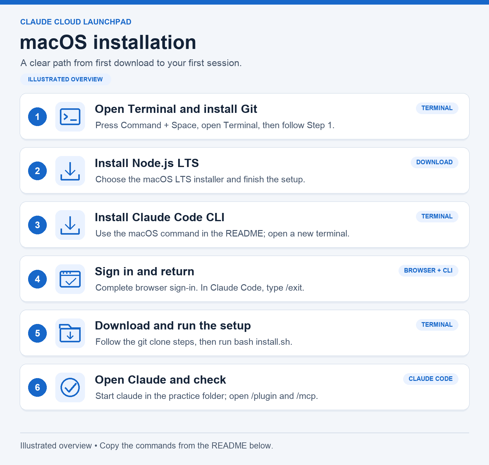
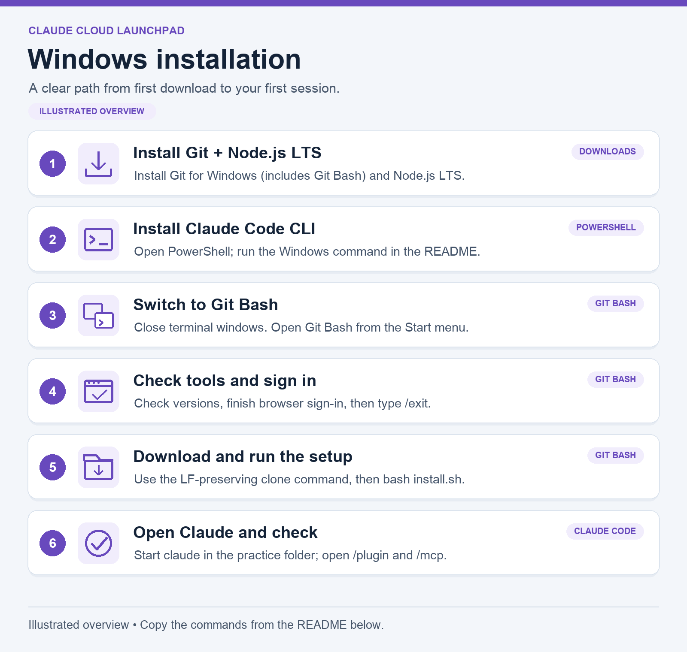

# Claude Cloud Launchpad

A beginner-friendly way to add AWS, Terraform, collaboration, and design tools to Claude Code on **macOS or Windows**.

[Start here](#start-here) · [macOS guide](#install-on-macos) · [Windows guide](#install-on-windows) · [First use](#try-your-first-session) · [Help](#troubleshooting)

## Start here

You will install a few basic apps, sign in to Claude Code, and run one setup script. The script adds **nine plugins** and an **AWS Pricing Calculator connector**. A plugin gives Claude extra capabilities; a connector, also called an MCP server, lets it work with another tool or service.

**You need:** an internet connection and an account or provider configuration that can use Claude Code. The **Claude Code terminal app** is required; using the Claude website or installing Claude Desktop alone does not guarantee that the `claude` terminal command is available.

Choose **one** guide below. You can connect AWS, GitHub, Slack, and other services later, when you need them. Each person uses their own accounts and credentials.

**How to follow this guide**

- A terminal is the app where you type commands. On a Mac, use **Terminal**. On Windows, use **PowerShell** first and then **Git Bash**, as labelled below.
- Copy commands from the text boxes, one line at a time. Press **Enter** after each line and wait for it to finish.
- Commands such as `git clone` go in your terminal. Commands beginning with `/`, such as `/plugin`, go **inside Claude Code**.
- The pictures are illustrated overviews. Use the selectable command text below them for installation.

## Install on macOS



### Step 1 — Open Terminal and install Git

Press **Command + Space**, type **Terminal**, and press **Return**.

In **Terminal**, run:

```bash
xcode-select --install
```

If a macOS installation window appears, follow its instructions and wait for it to finish. This installs Apple's command-line tools, including Git. If it says the tools are already installed, continue. See [Apple's installation guide](https://developer.apple.com/documentation/xcode/installing-the-command-line-tools) if you get an error.

### Step 2 — Install Node.js

Open [nodejs.org/download](https://nodejs.org/en/download), select a current **LTS** version and **macOS**, and download the **Installer (.pkg)** for your Mac. Open the downloaded file and follow the installer. Node.js includes `npm` and `npx`, which the pricing connector needs.

### Step 3 — Install Claude Code

In **Terminal**, paste the [official Claude Code installation command](https://code.claude.com/docs/en/setup#install-claude-code):

```bash
curl -fsSL https://claude.ai/install.sh | bash
```

If you already have a current Claude Code terminal installation, you can skip that command.

**Close Terminal and open a new Terminal window.** Run each check:

```bash
git --version
node --version
npx --version
claude --version
```

**What success looks like:** every command prints a version number. If any says “command not found,” stop and use [Troubleshooting](#troubleshooting) before continuing.

### Step 4 — Sign in

In **Terminal**, run:

```bash
claude
```

Follow the sign-in instructions. A browser may open; complete sign-in there, then return to Terminal. When Claude is ready, type **`/exit` inside Claude Code** and press Enter to return to the regular terminal.

### Step 5 — Download and run this setup

In **Terminal**, run:

```bash
cd "$HOME"
git clone https://github.com/ydsveluvolu2996/claude-cloud-launchpad.git
cd claude-cloud-launchpad
bash install.sh
```

The first command goes to your home folder. The next downloads this repository into a new `claude-cloud-launchpad` folder. The last installs the plugins and configures the pricing connector for your user account.

**What success looks like:** the final summary says **`Done. Setup completed.`** You will also see a list of next steps. If it says **`Finished with errors`**, use the error message and the troubleshooting table below, then retry.

Continue to [Try your first session](#try-your-first-session).

## Install on Windows



### Step 1 — Install Git for Windows and Node.js

1. Download the **standalone installer** from [Git for Windows](https://git-scm.com/install/windows). Run it using its default options. This includes an app called **Git Bash**.
2. Open [nodejs.org/download](https://nodejs.org/en/download), select a current **LTS** version and **Windows**, and download the **Installer (.msi)** for your computer. Run it with the default options, including **Add to PATH**.

“PATH” lets your terminal find an installed app by its name. You do not need to edit it manually if the installers configure it correctly.

### Step 2 — Install Claude Code in PowerShell

Open the **Start menu**, type **PowerShell**, and open it. A normal PowerShell window is sufficient; you do not need “Run as administrator” for the Claude installer.

In **PowerShell**, run the [official Windows installation command](https://code.claude.com/docs/en/setup#set-up-on-windows):

```powershell
irm https://claude.ai/install.ps1 | iex
```

If you already have a current Claude Code terminal installation, you can skip that command.

### Step 3 — Switch to Git Bash

**Close your terminal windows.** Open the **Start menu**, search for **Git Bash**, and open it. Use **Git Bash for the rest of the basic setup**.

Run each check in **Git Bash**:

```bash
git --version
node --version
npx --version
claude --version
```

**What success looks like:** every command prints a version number. If a command is missing, fix it using [Troubleshooting](#troubleshooting) before continuing.

### Step 4 — Sign in

In **Git Bash**, run:

```bash
claude
```

Complete the sign-in prompts, including any browser step. Return to Git Bash, then type **`/exit` inside Claude Code** and press Enter to return to the regular terminal.

### Step 5 — Download and run this setup

Run these commands in **Git Bash**, not PowerShell:

```bash
cd "$HOME"
git clone --config core.autocrlf=false https://github.com/ydsveluvolu2996/claude-cloud-launchpad.git
cd claude-cloud-launchpad
bash install.sh
```

The clone option keeps the script's line endings compatible with Bash. Keep it exactly as shown.

**What success looks like:** the final summary says **`Done. Setup completed.`** If it says **`Finished with errors`**, use the error details below it or in the preceding output to fix the problem, then retry.

Continue to the next section.

## Try your first session

Use **Terminal on macOS** or **Git Bash on Windows**. These commands create a practice folder and start Claude there:

```bash
mkdir -p "$HOME/claude-practice"
cd "$HOME/claude-practice"
claude
```

If Claude asks whether you trust this folder, review the prompt. This is the practice folder you just created.

**Inside Claude Code**, enter these commands separately:

```text
/plugin
/mcp
```

- **`/plugin`** shows installed plugins. Check that the nine plugins in [What's included](#whats-included) are listed.
- **`/mcp`** shows connectors and whether they are connected or need configuration. Find `aws-pricing-calculator`. On its first run, `npx` may need time to download the pricing package.
- Optional services may show as disconnected until you install their extra software or sign in. Follow [Connect the tools you need](#connect-the-tools-you-need) for those features.

### Prompts you can try

Type one of these **inside Claude Code** in your own words:

> Explain the difference between EC2, S3, and Lambda using a simple website example. Do not create or change any cloud resources.

> Use the design plugin to review this page text for clarity and accessibility: [paste your sample text].

> Use AWS Pricing Calculator to draft an estimate for a small test website. Ask me about region, usage, and budget first. Do not deploy anything.

The calculator estimates costs; creating an estimate does not create AWS resources. Real cloud operations require your own AWS account configuration and permissions.

### How to open it next time

Open **Terminal** or **Git Bash**, go to the folder you want to work in, and run `claude`. You do not need to rerun the installer for every session.

For the same practice folder:

```bash
cd "$HOME/claude-practice"
claude
```

## Connect the tools you need

**Basic setup is complete once the plugins are installed and the pricing connector works.** Set up the following only for the features you plan to use.

| I want to use… | What to do next |
|---|---|
| AWS Pricing Calculator | Keep Node.js and `npx` available. The default calculator workflow does not need AWS credentials. |
| AWS tools | Install [uv](https://docs.astral.sh/uv/getting-started/installation/) so `uvx` is available, use a supported Python 3 installation, and configure your own AWS account/profile. Start with read-only permissions. |
| Terraform tools | Install [Docker](https://docs.docker.com/get-started/get-docker/) and start Docker Desktop. Configure Terraform service credentials if your workflow needs them. |
| GitHub tools | The bundled plugin requires your own `GITHUB_PERSONAL_ACCESS_TOKEN` environment variable in the terminal that launches Claude. Follow the [plugin configuration](https://github.com/anthropics/claude-plugins-official/blob/main/external_plugins/github/.mcp.json) and [GitHub's token guide](https://docs.github.com/en/authentication/keeping-your-account-and-data-secure/managing-your-personal-access-tokens); request only the permissions you need. |
| Slack or Atlassian | Open `/mcp` inside Claude, select the relevant connector, and follow its sign-in instructions using your workspace/site account. |
| AWS DevSecOps tools | Follow the plugin's [service setup instructions](https://github.com/aws/agent-toolkit-for-aws/tree/main/plugins/aws-agents-for-devsecops). |
| Architecture diagrams | Expand the optional diagram setup below. Its validation hook needs extra local tools. |

Some plugins, including design, include optional connectors. Configure the ones you use and disable unused connectors through Claude Code's supported settings.

**Keep credentials private.** Use your own accounts, keep permission prompts enabled, and never put tokens or AWS keys into this repository, issues, or screenshots. This installer does not grant or enforce AWS permissions.

<details>
<summary><strong>Optional: architecture diagrams and Windows WSL setup</strong></summary>

The upstream [diagram validation hook](https://github.com/awslabs/agent-plugins/blob/fbefb3764e67558fe10ac834dd85db49734aa9b6/plugins/deploy-on-aws/scripts/validate-drawio.sh) runs **`python3`** and **GNU `timeout`**. It also needs `defusedxml>=0.7.1` installed in that Python environment. Having only a `python` command is insufficient.

### macOS diagrams

Install a supported [Python 3 release](https://www.python.org/downloads/) and [Homebrew](https://brew.sh/) if needed. In **Terminal**:

```bash
brew install coreutils
export PATH="$(brew --prefix coreutils)/libexec/gnubin:$PATH"
python3 -m venv "$HOME/.venvs/claude-cloud-launchpad"
source "$HOME/.venvs/claude-cloud-launchpad/bin/activate"
python3 -m pip install "defusedxml>=0.7.1"
python3 -c "import defusedxml; print('defusedxml OK')"
timeout --version
claude
```

A virtual environment keeps these Python packages separate from your system Python. In a new terminal, repeat the `export PATH` and `source` lines before launching Claude for diagram work.

### Windows diagrams using WSL 2

For diagram validation on Windows, use **WSL 2**, a Linux environment inside Windows. Follow [Microsoft's WSL installation guide](https://learn.microsoft.com/en-us/windows/wsl/install) first.

Open your **Ubuntu/WSL terminal** and install Linux Git, Node.js, Claude Code, and uv there. Windows-native installations and credentials are separate. Run this repository's clone and `bash install.sh` commands inside WSL too.

Then, in the **Ubuntu/WSL terminal**:

```bash
sudo apt update
sudo apt install python3 python3-venv coreutils
python3 -m venv "$HOME/.venvs/claude-cloud-launchpad"
source "$HOME/.venvs/claude-cloud-launchpad/bin/activate"
python3 -m pip install "defusedxml>=0.7.1"
python3 -c "import defusedxml; print('defusedxml OK')"
timeout --version
claude
```

Native Git Bash remains suitable for the basic installation. Its diagram hook additionally needs a working `python3` with `defusedxml` and GNU `timeout`; Windows' built-in `timeout.exe` is not equivalent. In a new WSL terminal, reactivate the Python environment before using diagrams.

</details>

## What's included

| Plugin or connector | What it helps with |
|---|---|
| `aws-core` | AWS APIs, infrastructure, containers, monitoring, and billing |
| `aws-agents-for-devsecops` | Investigations, release readiness, and vulnerability scans |
| `deploy-on-aws` | Architecture diagrams and cost estimates |
| `terraform` | Terraform provider and module documentation |
| `github` | Repositories, pull requests, and issues |
| `atlassian` | Jira and Confluence |
| `slack` | Channels and conversations |
| `session-report` | Claude Code usage and cost reports |
| `design` | Design critique, UX writing, accessibility, and handoff |
| `aws-pricing-calculator` (MCP connector) | AWS Pricing Calculator estimates and shareable links |

## Troubleshooting

| What you see | What to do |
|---|---|
| “Command not found” or “not recognized” | Install the named app, close the terminal, and open a new one. Repeat the version checks. For `claude`, see [Claude's PATH troubleshooting](https://code.claude.com/docs/en/troubleshooting). |
| `irm` is not recognized | The Windows Claude install command belongs in **PowerShell**, not Git Bash or Command Prompt. |
| `bash` is not recognized in PowerShell | Open **Git Bash** from the Start menu and continue there. |
| “Destination path … already exists” when cloning | You already have a folder with that name. If it is this setup, enter `cd "$HOME/claude-cloud-launchpad"` and use the update steps below. Do not delete a folder containing your own work. |
| Errors mentioning `\r` or `^M` on Windows | Use a fresh clone with `--config core.autocrlf=false`, as shown in the Windows guide. |
| “Finished with errors” | Read the specific error above the summary. Check internet access, missing prerequisites, and organization policy, then retry the installer. |
| A connector is disconnected | Open `/mcp` in Claude. Check its sign-in and prerequisites: Terraform needs running Docker; AWS tools need `uvx`. |
| Pricing works only inside the setup folder | Rerun the current installer, then verify from the separate practice folder. |
| GitHub authentication fails | Ensure your own `GITHUB_PERSONAL_ACCESS_TOKEN` is available to the terminal that launches Claude. Never paste it into an issue. |
| Diagram validation fails | Use the optional diagram guide and verify `python3` can import `defusedxml`, and `timeout --version` identifies GNU coreutils. |

To retry setup, first type `/exit` if you are inside Claude. Then, in **Terminal or Git Bash**:

```bash
cd "$HOME/claude-cloud-launchpad"
bash install.sh
```

## Update this setup

In **Terminal or Git Bash**:

```bash
cd "$HOME/claude-cloud-launchpad"
git pull --ff-only
bash install.sh
```

To update installed plugin versions, use the update controls in `/plugin` inside Claude. Pulling this repository alone does not update every plugin. The pricing package is deliberately pinned to `sample-aws-pricing-calculator-mcp@1.3.4`; rerunning setup preserves an existing user-scoped pricing-server configuration.

<details>
<summary><strong>Technical details, validation, and official references</strong></summary>

### Where settings apply

- `install.sh` installs plugins and the pricing server at **user scope**, so they can be used in other project folders.
- `.claude/settings.json` enables/recommends the same plugins when you open this checkout.
- `.mcp.json` supplies the pricing server at **project scope** in this checkout. Project settings take precedence over a same-name user setting; that is why the first-use guide starts in a separate practice folder.
- Existing user-scoped pricing-server settings are preserved. To inspect them, run `claude mcp get aws-pricing-calculator` from outside this checkout; this may start a server connection check.
- Current Claude Code supports plain `npx` on native Windows; the old `cmd /c` workaround is not required.

### What has been checked

Bash syntax, JSON configuration, plugin/package availability, executable permissions, public cloning, and 11 isolated installer scenarios using simulated commands. These tests cover fresh setup, existing MCP settings, missing prerequisites, and installation failures. The installer returns a nonzero status when a required step fails.

Simulated tests do not install real plugins or authenticate services. Native Windows execution and live service connections still need verification on each user's machine. No AWS account access is included in this repository.

### Official references

- [Claude Code installation](https://code.claude.com/docs/en/setup)
- [Plugin installation and scopes](https://code.claude.com/docs/en/discover-plugins)
- [MCP configuration](https://code.claude.com/docs/en/mcp)
- [Official plugin catalog](https://github.com/anthropics/claude-plugins-official/blob/main/.claude-plugin/marketplace.json)
- [Knowledge-work design plugin](https://github.com/anthropics/knowledge-work-plugins/tree/main/design)
- [AWS Pricing Calculator MCP](https://github.com/aws-samples/sample-aws-pricing-calculator-mcp)
- [Claude Code changelog](https://github.com/anthropics/claude-code/blob/main/CHANGELOG.md)

</details>
